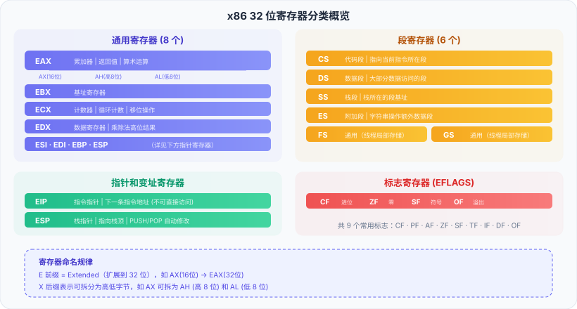

### 通用寄存器

| 32位 | 16位 | 低8位 | 低16位中的高8位 | 主要用途                 |
| --- | --- | --- | --------- | -------------------- |
| eax | ax  | al  | ah        | 累加器，存放函数返回值、算术运算结果\| |
| ebx | bx  | bl  | bh        | 32位通用寄存器             |
| ecx | cx  | cl  | ch        | 32位通用寄存器             |
| edx | dx  | dl  | dh        | 32位通用寄存器             |
| esi |     |     |           |                      |
| edi |     |     |           |                      |
| ebp |     |     |           | 指向当前栈的底部             |
| esp |     |     |           | 栈顶指针                 |

| 指令    | 解释                                                                               |
| ----- | -------------------------------------------------------------------------------- |
| cld   | DF=0, 字符串操作正向递增                                                                  |
| lodsd | 1.从 `DS:ESI` 指向的内存地址读取 4 字节数据。 2.将读取的数据存入 `EAX`。 3.根据方向标志 `DF` 自动调整 `ESI`。 |
| stosd |                                                                                  |
|       |                                                                                  |
